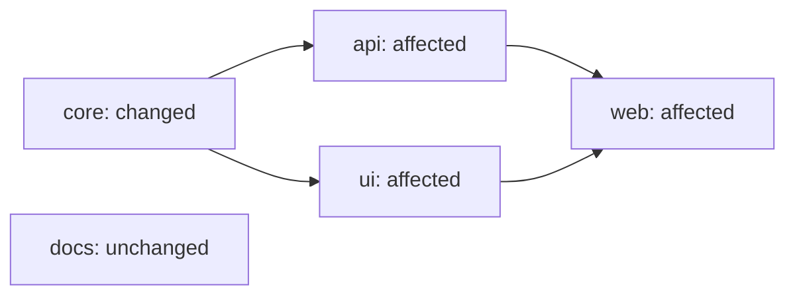

# Change Scope

[](https://github.com/Dcastroro/change-scope/actions/workflows/ci.yml)
[](https://github.com/Dcastroro/change-scope/releases)


[](LICENSE)

**Turn local Git changes into an affected-project plan for monorepo CI.**

A shared package changes. Its API and UI consumers need testing, and so does
the application that depends on both. An unrelated documentation app can wait.
Change Scope makes that selection explicit, with dependency reasons and bounded
CI shards. Unknown ownership selects everything by default.

No service account, API key, third-party npm package or repository script execution.
The planner runs locally; Git mode uses bounded, read-only Git subprocesses.



## Try it

Requires Node.js 22+ and Git 2.43+ for Git mode. The source is distributed on
GitHub; this project is not published to npm.

```sh
git clone https://github.com/Dcastroro/change-scope.git
cd change-scope
npm ci --ignore-scripts
npm run demo
```

The fixture changes `core` and a documentation file. The resulting selection is
`core → api + ui → web`; `docs` is excluded. The report contains IDs and counts,
without changed filenames or file contents.

```sh
# Explicit JSON inputs, without Git access
node bin/change-scope.mjs plan --config examples/monorepo.json --changes examples/changes.json

# Committed configuration and changes from a feature branch's merge base
node bin/change-scope.mjs plan --repo /path/to/monorepo --base origin/main --head HEAD --format json

# Compare two exact commit trees instead
node bin/change-scope.mjs plan --base HEAD~1 --head HEAD --comparison direct --format matrix
```

Git mode never fetches missing history. Prepare the required commits separately.
Dirty, staged and untracked files do not enter the committed comparison. The
configuration is read from the requested head commit, even if another branch
is checked out locally.

## Declare ownership

Save this as `change-scope.json` in your monorepo:

```json
{
  "version": 1,
  "projects": [
    { "id": "core", "root": "packages/core", "inputs": ["tooling/types/"] },
    { "id": "api", "root": "apps/api", "dependsOn": ["core"] },
    { "id": "web", "root": "apps/web", "dependsOn": ["api"] }
  ],
  "globalInputs": ["tooling/build/"],
  "ignoredInputs": ["docs/", "README.md"],
  "unmapped": "all"
}
```

| Field | Meaning |
| --- | --- |
| `id` | Stable lowercase project ID, up to 64 ASCII letters, digits or hyphens; starts with a letter. |
| `root` | Repository-relative directory; selects that project for files at or below it. |
| `dependsOn` | Explicit project dependencies; effects propagate to their consumers. |
| `inputs` | Additional exact file paths or directory prefixes ending in `/`. |
| `globalInputs` | Additional selectors that select every project. |
| `ignoredInputs` | Selectors applied only to paths with no owner and no global match. |
| `unmapped` | `all` (default) selects everything; `error` blocks unknown ownership. |

Selectors are case-sensitive, literal paths. There are no globs or automatic
package-manager dependency discovery. Overlapping ownership selects every
matching owner. Configuration, root lockfiles, root `package.json` and `.github/`
are always global inputs in Git mode. See the complete built-in list in
[architecture](docs/architecture.md).

## Consume the plan

```js
import { planImpact, planGit } from './src/index.mjs';

const plan = planImpact(config, ['packages/core/src/index.mjs']);
console.log(plan.projects); // dependency-first affected IDs
console.log(plan.batches); // dependency-respecting affected groups
console.log(plan.reasons); // direct, dependent, global or unmapped

const committed = planGit({ repo: '.', base: 'origin/main', head: 'HEAD' });
console.log(committed.comparison); // resolved commit hashes, no raw refs
```

JavaScript callers must supply dense `dependsOn` arrays with an own value at
every index. Holes, including entries supplied only by an array prototype,
are rejected with `invalid-dependency`. Omitted dependencies and empty arrays
remain valid. JSON files cannot represent array holes.

`--format matrix` returns only a GitHub-compatible `include` object. Each shard
contains at most 64 project IDs. A 10,000-project selection produces 157 jobs,
without dropping projects. Use a concurrency limit when consuming it.

An empty plan has `include: []`: gate the downstream job before expanding its
matrix. Shards describe selected work; they do not coordinate build artifacts
or enforce order between CI jobs. Your build system must supply unchanged
prerequisites and execute the selected projects. See [CI integration](docs/ci.md).

Normal planning exits `0`. Add `--fail-if-affected` to exit `1` for a nonempty
plan. Invalid input, missing Git history and resource limits exit `2`, with a
fixed diagnostic code. A failed plan must block CI rather than imply no changes.
See [diagnostic codes](docs/diagnostics.md) for remediation.

## Bounded by design

- Up to 10,000 projects, 100,000 dependency edges and 100,000 changed paths.
- Prefix-trie ownership lookup; iterative dependency propagation and batching.
- 1 MiB configuration, 8 MiB change input and 1,000,000 selector-match budget.
- A shared 15-second deadline bounds all Git calls; oversized output fails closed.
- Reports omit changed paths, source contents, raw refs and local filesystem paths.

Configured project IDs and resolved commit hashes are intentional report data.
Review those IDs before publishing logs. The accuracy of a selective plan
depends on complete dependency declarations; use conservative global inputs
and a full-suite CI lane when ownership is uncertain.

## Quality and delivery

```sh
npm run repo:check
npm run check
npm run demo
```

Includes real Git-history tests for renames, deletions, divergent branches,
committed-policy selection, disabled diff drivers and inherited Git locators;
seeded graph-oracle tests; and a 10,000-project / 100,000-path scale regression.
CI checks Windows and Ubuntu with Node.js 22 and 24.

[Validation evidence](VALIDATION.md) · [Security boundaries](SECURITY.md) ·
[Release process](RELEASING.md) · [Contributing](CONTRIBUTING.md) · [Changelog](CHANGELOG.md)

Change Scope selects affected work. [Task Relay](https://github.com/Dcastroro/task-relay)
executes declared task graphs, while [API Drift Guard](https://github.com/Dcastroro/api-drift-guard)
checks contract compatibility. Each tool handles a separate part of an automated workflow.
